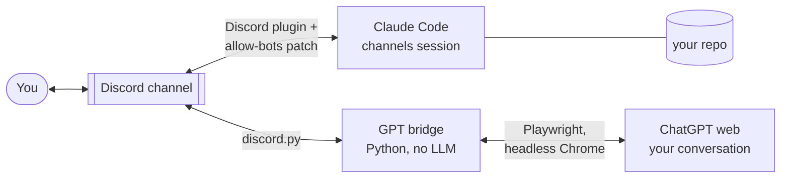

# claude-gpt-discord-bridge

**Put Claude Code and your ChatGPT in one Discord channel with you.**
Claude works in your repository; ChatGPT reviews, argues and draws. You talk to either of them, or let them talk to each other. When the AIs have gone back and forth a few times, the bridge stops them and waits for you.

- **No OpenAI API.** GPT is *your* ChatGPT conversation (projects, memory, model picker, image generation), driven through the web UI.
- **Zero Claude tokens for the GPT side.** The bridge is a plain Python program, not an LLM.
- **Nothing on screen.** Both pieces start hidden when you open a Claude Code session.



## Why

I wanted two assistants with different strengths on one problem. Claude Code edits files, runs things and commits. ChatGPT, inside a project with my notes and memory, is a good critic. Getting them to work together meant copy-pasting between two windows, so I was the message bus.

The obvious fixes cost too much or lose something:

| Option | Problem |
| --- | --- |
| OpenAI API for the GPT side | Pay per token, and you lose the ChatGPT project, memory and tools you already use |
| One long Claude session relays everything | Every relayed message re-reads a huge context: expensive, slow |
| Telegram group | Telegram bots cannot see other bots' messages, so the AIs cannot hear each other |
| Discord, out of the box | The Claude Code Discord plugin drops all bot messages (`if (msg.author.bot) return`) |

So the design goals became:

1. GPT costs nothing extra: no API key, no Claude tokens.
2. Claude only spends tokens when someone actually calls it.
3. A human stays in charge. AI-to-AI loops are capped, and only a human can press "Allow" on Claude's permission prompts.
4. It survives plugin updates and ChatGPT restarts, and it never pops up a window.

## What you get

- **@GPT** in the channel: everything said since GPT's last turn goes to ChatGPT in one batch, each line tagged with its speaker (`[User] …`, `[Claude] …`). The reply comes back as the GPT bot, split at Discord's 2000-character limit with numbered parts.
- **@Claude**: a normal [Claude Code channels](https://docs.claude.com/en/docs/claude-code) session working in your project. It reads the history when it needs context.
- **AI ↔ AI**: when GPT writes `@Claude`, the bridge turns it into a real mention, and Claude sees it. When Claude mentions GPT, GPT answers. After `loop_cap` (default 4) AI messages without a human, GPT posts one line and stops until a human speaks.
- **Files and images, both ways**: attachments posted to the channel are uploaded to ChatGPT. Files ChatGPT produces (code-interpreter downloads) and images it generates are attached to GPT's message.
- **Web mirror**: if you type into ChatGPT directly, the bridge notices within a minute and posts your question and the answer to the channel.
- **Handoff**: `!gpt new` asks the old chat for a handoff summary, then opens a fresh chat in the same ChatGPT project, seeded with the summary. This also happens automatically every `rollover_turns` turns.
- **Nothing gets dropped**: if ChatGPT errors out or takes your message back, the batch is requeued and retried after a reload, merged with anything said in the meantime. If ChatGPT says the chat is too long, the bridge rolls over to a new chat and resends.
- **A channel you can follow** (optional `log_channel_id`): the main channel carries results, questions and decisions in plain words. Commits, hashes, test counts, AI-to-AI technical review and the bridge's housekeeping go to a log channel you can mute. GPT reads both and answers where it was asked.
- **Status board**: Claude keeps `data/status.md` current: what is running, what just finished, what waits for you, and what comes next. The bridge shows it as one pinned message in the main channel and edits it in place, so you can see where things stand without asking, and nobody gets pinged.
- **Reports from your other sessions**: any other Claude Code session can drop a finished report into `data/reports/<name>.md`. The bridge posts it to the log channel and mentions Claude. Claude reads the full file and tells you in plain words what it means and what needs your decision. You no longer have to copy reports between sessions by hand.
- **Pause button**: `!halt` makes GPT stop answering and tells Claude to stop after its current step; `!resume` picks up where they left off. Nothing is killed.
- **Claude watch (zero tokens)**: the bridge reads Claude's session transcript. When Claude hits its usage limit, the bridge posts when it resets and tells Claude to continue at that time. When Claude's context grows past `claude_watch.ctx_limit`, the bridge asks it to write a handoff and request a fresh session. The bridge then restarts it, and the new session reads the handoff. Long sessions stop wasting quota.
- **Permission prompts**: Claude's tool approvals arrive as Allow/Deny buttons, either in the channel (`permissions_in_channel`) or in your DMs. In the channel the prompt says what exactly Claude wants to do (the file, the command, the diff, the URL), not just the tool name. Only allowlisted humans can press them; GPT cannot approve anything.

## How it works

### 1. Letting Claude hear another bot: a runtime patch, not a fork

The official plugin (`discord@claude-plugins-official`) ignores every message from a bot. Forking it would break on each plugin update. `--plugin-dir` does not work either, because `--channels` only accepts installed, allowlisted plugins unless you confirm a dev-mode prompt at every start, and that prompt cannot be answered in a hidden window.

[`plugin-patch/allow-bots.mjs`](plugin-patch/allow-bots.mjs) is a [Bun preload](https://bun.sh/docs/runtime/bunfig#preload) that wraps the plugin's `messageCreate` listener at runtime. `BUN_OPTIONS=--preload=…` is set only in the environment of the group-chat Claude session, so other sessions and the plugin cache are untouched. The patch:

- lets through only bot IDs listed in `DISCORD_ALLOW_BOT_IDS`, and only when they @mention Claude, so Claude is not billed for every GPT message;
- drops any bot message shaped like a permission reply (`yes abcde`), so a bot can never approve a tool call;
- optionally skips human messages addressed only to GPT (`DISCORD_SKIP_HUMAN_TO_BOT_IDS`);
- optionally posts permission prompts in a channel instead of DMs (`DISCORD_PERMISSION_CHANNEL_ID`): it wraps discord.js's `User.send` for messages carrying the plugin's permission buttons, and the plugin's own click handler still checks the allowlist. The plugin's prompt names only the tool, so the patch also reads the request details Claude Code sends on the plugin's stdin (a second listener; the MCP transport still gets every byte) and writes them into the post;
- still goes through the plugin's own `access.json` gate afterwards.

(Bun gives discord.js's client its own instance-level `emit`, so the patch wraps listeners at registration time rather than patching `emit`.)

### 2. Driving ChatGPT without an API

[`bridge/gpt_bridge.py`](bridge/gpt_bridge.py) is a discord.py bot plus a Playwright persistent Chrome profile that you log into once.

- **Context sync, not history replay.** The bridge buffers what was said since GPT's last turn and sends it as one speaker-tagged message. GPT always knows the whole conversation, and nothing is sent twice.
- **Knowing when ChatGPT is done.** It waits until the turn's state is complete, the stop button is gone, and the text, images and files have stayed the same for a few seconds. Long reasoning is allowed up to `reply_timeout_s`; after that it posts what it has.
- **Exact markdown.** It clicks the reply's own Copy button. The page's clipboard calls are captured *inside the page*, so your system clipboard is never touched. Rendered DOM-to-markdown is the fallback.
- **Files.** Uploads go through ChatGPT's own file input. Outputs come from the reply's Download buttons and its generated-image gallery; link icons and citation favicons are skipped. Files are deduplicated by hash. Files over the server's upload limit (10 MB without boosts, or `max_file_mb`) are listed by name, as are uploads Discord rejects with 413.
- **Failures.** While waiting, the bridge checks that its message is still in the chat. A vanished message, a ChatGPT error, or a finished turn with nothing in it raises a failure instead of posting an empty reply. The batch goes back to the front of the queue and is retried after 30 s and 60 s; after three failures the bridge says so once and keeps the batch for the next @GPT. Reply shapes it cannot parse are sent as their visible text, and the turn's HTML is saved in `data/logs` so the reader can be fixed.
- **Discord formatting.** Discord does not render markdown tables, so narrow tables become aligned code blocks and wide ones become bullet lists. Link previews are suppressed.
- **Mirror.** When idle, it reloads the chat every `mirror_interval_s` seconds. Every new finished turn that it did not send itself is one you typed, so it posts those turns, oldest first. That includes a turn that the bridge's own next message has already pushed down the page. If you carry on in another chat of the same ChatGPT project, that chat becomes the newest one in the sidebar. Once the bridge has seen that on two checks in a row, it follows you there. From then on it posts that chat's recent turns, and channel messages go to that chat, with the intro.
- **Loop cap.** The bridge is the one party that can refuse to answer, so the cap lives there.
- **Selectors are config.** ChatGPT's markup changes. Every selector is in `config.json`, and `--probe` shows what the page looks like without sending anything.

### 3. Starting invisibly

[`scripts/ensure.ps1`](scripts/ensure.ps1) runs from a Claude Code `SessionStart` hook. It checks whether each piece is running and starts the missing ones with `Win32_Process.Create`, in a hidden console, outside the calling session's process tree, so they outlive it. It is idempotent, has a 60-second launch lock, and prints nothing (hook output would end up in the session's context).

## Setup (Windows, tested)

**You need:** Claude Code CLI with the Discord channel plugin installed and configured (`/discord:configure`; the plugin also needs [Bun](https://bun.sh)), Python 3.10+, Google Chrome, and a Discord server where you and your Claude bot already are.

1. **Create the GPT bot.** [Discord Developer Portal](https://discord.com/developers/applications) → New Application "GPT" → Bot → turn on **Message Content Intent** → Reset Token. Invite it with View Channels, Send Messages, Read Message History and Attach Files:
   `https://discord.com/oauth2/authorize?client_id=<GPT_APP_ID>&scope=bot&permissions=101376`
2. **Install.**
   ```bash
   git clone https://github.com/TanoZhang/claude-gpt-discord-bridge
   cd claude-gpt-discord-bridge
   python -m venv .venv
   .venv\Scripts\pip install -r requirements.txt
   ```
3. **Configure.** Copy `config.example.json` to `config.json` and fill in the channel, your user ID, both bot IDs (Discord → Developer Mode → right-click → Copy ID), your ChatGPT conversation URL and its project URL, and `claude.workdir`. Put the GPT token in `gpt-bot.env` as `GPT_BOT_TOKEN=…`. Both files are gitignored.
4. **Open the channel to both bots.** In `~/.claude/channels/discord/access.json`:
   ```json
   "groups": { "<channel id>": { "requireMention": true, "allowFrom": ["<your user id>", "<GPT bot id>"] } },
   "mentionPatterns": ["(^|\\s)@(bot)?claude\\b"]
   ```
   The bridge reads the same `allowFrom`, so people you add there can use both bots.
5. **Log in to ChatGPT once.** `.venv\Scripts\python bridge\gpt_bridge.py --login` opens a Chrome window with the bridge's own profile. Log in, pass any check yourself, and close the window. Then run `--probe` to confirm the page is readable.
6. **Start.** `powershell -ExecutionPolicy Bypass -File scripts\ensure.ps1`. To start it with every Claude Code session, add the `SessionStart` hook shown at the top of `ensure.ps1` to your project's `.claude/settings.local.json`.

**Linux and macOS (untested):** the bridge is cross-platform. Run `python bridge/gpt_bridge.py` and start Claude inside `tmux` with the same environment variables and flags that `scripts/launch-claude.ps1` sets.

## Commands

| In Discord | Effect |
| --- | --- |
| `@GPT …` / `GPT: …` / reply to GPT | Ask GPT (with everything since its last turn) |
| `@Claude …` / reply to Claude | Ask Claude |
| `!gpt status` | Browser, loop counter, turns in this chat, chat URL |
| `!gpt new` / `!gpt new fresh` | New chat in the project, with or without a handoff summary |
| `!gpt url <link>` | Switch to another ChatGPT conversation |
| `!gpt cap <n>` | Change the loop cap |
| `!gpt show` / `!gpt hide` | Show the browser to log in or pass a check, then hide it |
| `!halt` / `!resume` | Pause the group (GPT quiet, Claude stops after its current step) / continue |

Stop or restart: `scripts\stop.ps1 [-Restart]`. A restarted Claude session starts fresh; `scripts\launch-claude.ps1 -Resume <session-id>` continues an old one.

## Configuration

| Key | Default | Meaning |
| --- | --- | --- |
| `loop_cap` | 4 | AI messages in a row before GPT pauses |
| `mirror_interval_s` | 60 | How often to look for turns typed in ChatGPT itself (0 = off) |
| `rollover_turns` | 40 | Automatic handoff to a new chat (0 = off) |
| `reply_timeout_s` | 900 | Longest wait for one reply |
| `context_max_chars` | 12000 | Most channel text sent to GPT in one turn |
| `browser_mode` | `headless` | `headless` or `headed` |
| `permissions_in_channel` | `true` | Claude's Allow/Deny buttons in the channel instead of DMs (takes effect when Claude restarts) |
| `max_file_mb` | server limit | Cap for files posted to Discord |
| `claude_watch.ctx_limit` | 150000 | Claude context (tokens) at which the bridge asks for a fresh session |
| `intro` / `handoff_prompt` | English | What GPT is told about the group, and how it is asked for a summary |
| `strings` | `{}` | Override or translate any message the bridge posts |
| `selectors` | ChatGPT as of 2026-11 | Fix these when ChatGPT's markup changes |

## Caveats

- **The ChatGPT web UI changes.** When it breaks, run `--probe`, then update `selectors`. Tested with Claude Code 2.1.318, Discord plugin 0.0.4 and chatgpt.com in November 2026.
- **Automating the ChatGPT website may conflict with OpenAI's terms.** Personal use, at your own risk. The bridge never solves logins or human checks; you do those in the window.
- **`data/` holds a browser profile that is logged into your ChatGPT.** Treat it like a password.
- One bridge per profile and per conversation. While idle, the mirror reloads the chat once a minute.

## Credits

Built by [TanoZhang](https://github.com/TanoZhang) with **[Claude Code](https://claude.com/claude-code)**. The code, scripts and this README were written by Claude (Anthropic, Claude Opus 5.5) in a pair-programming session. Commits carry a `Co-Authored-By: Claude` trailer.

MIT licensed.
